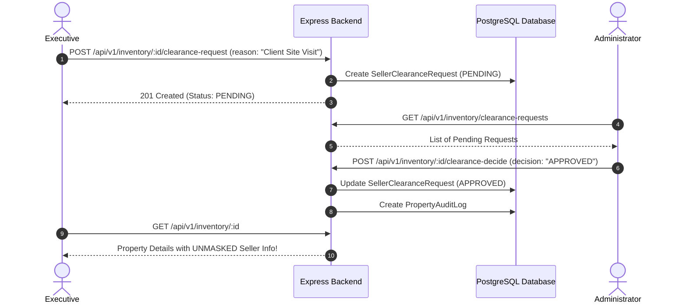

# Triumph CRM - API & Endpoint Testing Guide

A comprehensive, edge-case testing manual designed for backend engineers and QA specialists to test, validate, and debug all **Triumph CRM** API endpoints using **Swagger UI**, **Postman**, or **cURL**.

---

## 1. Quick Access & Interactive Swagger UI

- **Interactive Portal:** [http://localhost:5000/api-docs](http://localhost:5000/api-docs) (Alias: [http://localhost:5000/docs](http://localhost:5000/docs))
- **OpenAPI 3.0.3 Specification:** [http://localhost:5000/api-docs.json](http://localhost:5000/api-docs.json)
- **Base API URL:** `http://localhost:5000/api/v1`

### Authentication in Postman & Swagger UI
The backend authenticates requests via an HTTP-only session cookie named `triumph_session` (stored in Redis).
1. Ensure your HTTP client retains cookies (Postman enables this automatically; in Swagger UI, the browser preserves cookies across requests).
2. Execute `POST /api/v1/auth/login` to establish the session.
3. Once authenticated, subsequent requests in the session will automatically include the `triumph_session` cookie.

---

## 2. System Health & Infrastructure

### `GET /health`
Validates connectivity to PostgreSQL and Redis.

- **URL:** `http://localhost:5000/health`
- **Method:** `GET`
- **Auth:** None (Public)
- **Expected Responses:**
  - `200 OK`: `{ "status": "ok", "services": { "database": "healthy", "redis": "healthy" } }`
  - `503 Service Unavailable`: When either PostgreSQL or Redis is unreachable.
- **Edge Cases to Test:**
  1. **All Services Up:** Run both PostgreSQL and Redis. Expect `200 OK`.
  2. **Database Offline:** Stop PostgreSQL (`docker stop triumph_postgres`). Expect `503 Service Unavailable` with `"database": "unhealthy"`.
  3. **Redis Offline:** Stop Redis (`docker stop triumph_redis`). Expect `503 Service Unavailable` with `"redis": "unhealthy"`.

---

## 3. Authentication Module (`/api/v1/auth`)

### A. Login
- **URL:** `http://localhost:5000/api/v1/auth/login`
- **Method:** `POST`
- **Headers:** `Content-Type: application/json`
- **Request Body:**
  ```json
  {
    "email": "admin@triumph.com",
    "password": "AdminSecurePassword123!"
  }
  ```
- **Edge Cases to Test:**
  1. **Valid Credentials (200):** Returns user profile (with password omitted) and sets `Set-Cookie: triumph_session=...; HttpOnly; SameSite=Lax`.
  2. **Invalid Password (401):** Valid email with incorrect password.
  3. **Non-Existent User (401):** Email that does not exist in the database.
  4. **Invalid Email Format (400):** Send `"email": "not-an-email"`. Expect Zod validation failure.
  5. **Missing Fields (400):** Send empty JSON `{}`. Expect field validation errors.
  6. **Brute Force Lockout Guard (429):** Send 5 consecutive incorrect password requests. The `loginLockoutGuard` will temporarily lock the account and return HTTP `429 Too Many Requests`.

### B. Logout
- **URL:** `http://localhost:5000/api/v1/auth/logout`
- **Method:** `POST`
- **Edge Cases to Test:**
  1. **Active Session (200):** Clears the `triumph_session` cookie and destroys the Redis session key.
  2. **Subsequent Call (401):** Requesting any protected route like `/api/v1/auth/me` or `/api/v1/users/me` immediately after logout returns `401 Unauthorized`.

### C. Verify Current Session
- **URL:** `http://localhost:5000/api/v1/auth/me`
- **Method:** `GET`
- **Edge Cases to Test:**
  1. **Authenticated (200):** Returns current user object and role (`ADMIN` or `EXECUTIVE`).
  2. **Unauthenticated (401):** Request without cookie returns `401 Unauthorized`.

---

## 4. User Administration (`/api/v1/users`)

### A. Self Profile Management
- `GET /api/v1/users/me` - Returns logged-in user profile.
- `PATCH /api/v1/users/me` - Updates own profile (e.g., `name`, `phoneNumber`).
- `PATCH /api/v1/users/me/password` - Updates own password (`oldPassword`, `newPassword`).

### B. Admin User Operations (`ADMIN` Role Required)
- **`GET /api/v1/users`** - List all users with pagination (`page`, `limit`) and role filtering (`role=EXECUTIVE`).
- **`POST /api/v1/users`** - Provision a new user:
  ```json
  {
    "name": "Sarah Connor",
    "email": "sarah@triumph.com",
    "password": "SecurePassword123!",
    "role": "EXECUTIVE",
    "phoneNumber": "+919876543210"
  }
  ```
- **`PATCH /api/v1/users/:id`** - Update an existing user's details, active status, or role.
- **`PATCH /api/v1/users/:id/password`** - Reset an existing user's password directly (Admin override).
- **`POST /api/v1/users/:id/verify`** - Manually mark a user's email as verified (`emailVerified = true`).
- **`DELETE /api/v1/users/:id`** - Permanently delete a user account.
- **`DELETE /api/v1/users/bulk`** - Bulk delete users by ID array:
  ```json
  {
    "userIds": ["user_id_1", "user_id_2"]
  }
  ```
- **Edge Cases to Test:**
  1. **Role Enforcement (403):** Call any of the above admin endpoints while logged in as an `EXECUTIVE`. Expect `403 Forbidden`.
  2. **Duplicate Email Creation (409):** Create a user with an email that already exists.
  3. **Weak Password (400):** Attempt to set a password shorter than 8 characters.

---

## 5. Master Resources (`/api/v1/resources`)

Centralized taxonomy management for CRM dropdowns. Requires `ADMIN` role.

Supported Resource Types:
1. **Lead Sources:** `/api/v1/resources/lead-sources`
2. **Inventory Categories:** `/api/v1/resources/inventory-categories`
3. **Pipeline Stages:** `/api/v1/resources/pipeline-stages`

### Endpoints for Each Resource:
- `GET /api/v1/resources/{resource-name}` - List active items.
- `POST /api/v1/resources/{resource-name}` - Create item (`{ "name": "Google Ads", "order": 1 }`).
- `PATCH /api/v1/resources/{resource-name}/:id` - Update name, sort order, or active state.
- `DELETE /api/v1/resources/{resource-name}/:id` - Remove item.

---

## 6. Leads Management (`/api/v1/leads`)

### Bulk CSV Lead Import
- **URL:** `http://localhost:5000/api/v1/leads/import`
- **Method:** `POST`
- **Headers:** `Content-Type: multipart/form-data`
- **Form Data:** Key: `file` (Type: File, upload a `.csv` document)
- **Edge Cases to Test:**
  1. **Valid CSV (200):** Ingests rows, validates names, emails, and phone numbers, and returns import statistics (`importedCount`, `duplicateCount`).
  2. **No File Uploaded (400):** Submit request without attaching a file.
  3. **Malformed File Format (400):** Upload a binary or corrupted file instead of CSV.

---

## 7. Inventory Properties (`/api/v1/inventory`)

### A. List Properties & Filters
- **URL:** `http://localhost:5000/api/v1/inventory`
- **Method:** `GET`
- **Query Parameters:**
  - `page=1&limit=10`
  - `search=Penthouse`
  - `status=ACTIVE` (`ACTIVE`, `UNDER_REVIEW`, `REJECTED`, `SOLD`)
  - `propertyType=RESIDENTIAL`
  - `listingType=RESALE` (`RESALE`, `BOOKING`, `RENTAL`)
  - `city=Gurgaon`
  - `minPrice=10000000&maxPrice=50000000`
- **Edge Cases to Test:**
  1. **Executive Masking:** When logged in as `EXECUTIVE`, verify that `sellerPhone` and sensitive seller fields return `"******"`.
  2. **Admin View:** When logged in as `ADMIN`, verify that seller details are fully visible.

### B. Master Data & Metrics
- `GET /api/v1/inventory/master-data` - Returns cities, property types, categories, and amenities for filter populating.
- `GET /api/v1/inventory/metrics` - Returns aggregate inventory numbers (total active, pending reviews, booking units count).

### C. Create Property
- **URL:** `http://localhost:5000/api/v1/inventory`
- **Method:** `POST`
- **Body Example:**
  ```json
  {
    "title": "DLF The Aralias Luxury 4 BHK",
    "propertyType": "RESIDENTIAL",
    "listingType": "RESALE",
    "price": 85000000,
    "bedrooms": 4,
    "bathrooms": 5,
    "city": "Gurgaon",
    "locality": "Golf Course Road",
    "sellerName": "Rohit Verma",
    "sellerPhone": "+919876543210",
    "areas": [
      { "areaType": "SUPER_AREA", "value": 4500, "unit": "SQ_FT" },
      { "areaType": "CARPET_AREA", "value": 3800, "unit": "SQ_FT" }
    ]
  }
  ```
- **Edge Cases to Test:**
  1. **Created by Admin:** Property immediately enters `ACTIVE` status.
  2. **Created by Executive:** Property is automatically saved with status `UNDER_REVIEW` awaiting admin approval.
  3. **Audit Log Generation:** Check that an entry is automatically created in `PropertyAuditLog`.

### D. File Uploads
- **URL:** `http://localhost:5000/api/v1/inventory/upload`
- **Method:** `POST`
- **Form Data:** `files` (Up to 10 image/PDF files, max 25MB each)
- **Response:** Returns array of uploaded public URLs.

---

## 8. Booking Project Units (`/api/v1/inventory/units/*`)

For properties with `listingType: "BOOKING"`, multiple individual inventory units can be registered and tagged to CRM leads.

### Endpoints:
- `GET /api/v1/inventory/:propertyId/units` - List all units for a given booking property.
- `POST /api/v1/inventory/:propertyId/units` - Add a unit (`unitNumber`, `floor`, `bhk`, `superArea`, `price`).
- `PATCH /api/v1/inventory/units/:unitId` - Update unit pricing or status (`AVAILABLE`, `HOLD`, `BOOKED`, `TAGGED`).
- `DELETE /api/v1/inventory/units/:unitId` - Remove unit (`ADMIN` only).
- `POST /api/v1/inventory/units/:unitId/tag` - Tag unit to a lead:
  ```json
  {
    "leadId": "lead_12345",
    "notes": "Client scheduled for site visit on Saturday"
  }
  ```
- **Edge Cases to Test:**
  1. **Tagging an Available Unit (200):** Changes unit status to `TAGGED` and logs audit record.
  2. **Tagging an Already Booked Unit (400/409):** Tagging fails if unit is already sold/booked.
  3. **Untagging / Releasing:** Setting `leadId: null` releases unit back to `AVAILABLE`.

---

## 9. Inventory Approvals Workflow (`ADMIN` Only)

### Approve Property
- **URL:** `http://localhost:5000/api/v1/inventory/:id/approve`
- **Method:** `POST`
- **Headers:** `Content-Type: application/json`
- **Body:** `{ "notes": "Verified title deed and registry" }`
- **Behavior:** Transitions property from `UNDER_REVIEW` to `ACTIVE`.

### Reject Property
- **URL:** `http://localhost:5000/api/v1/inventory/:id/reject`
- **Method:** `POST`
- **Headers:** `Content-Type: application/json`
- **Body:** `{ "reason": "Property pricing is 40% above prevailing circle rates" }`
- **Behavior:** Transitions property from `UNDER_REVIEW` to `REJECTED`.

---

## 10. Seller Clearance Workflow (`/api/v1/inventory/clearance-requests`)

Protects seller contact privacy while providing a structured approval process when an Executive needs to contact the seller.



### Endpoints to Test:
1. **`POST /api/v1/inventory/:id/clearance-request`** (Executive):
   ```json
   {
     "reason": "Client Site Visit Scheduled for 2:00 PM tomorrow"
   }
   ```
   - *Edge Case:* Reason shorter than 10 characters should be rejected with HTTP `400`.
   - *Edge Case:* Submitting duplicate pending request returns existing pending request or HTTP `409`.
2. **`GET /api/v1/inventory/clearance-requests`** (Admin & Executive):
   - Admin sees all pending/approved/rejected requests across all properties.
   - Executive sees only their own requests.
3. **`POST /api/v1/inventory/:id/clearance-decide`** (Admin only):
   ```json
   {
     "requestId": "req_abc123",
     "decision": "APPROVED",
     "adminNote": "Approved for client site visit"
   }
   ```
4. **Verification Step:**
   - Execute `GET /api/v1/inventory/:id` as the requesting executive.
   - Verify `sellerPhone` and seller contact details are now fully unmasked!

---

## 11. Audit Logs & System Forensics (`/api/v1/logs`)

Requires `ADMIN` role.

- **`GET /api/v1/logs`** - Query system-wide property audit logs with pagination (`page`, `limit`) and filters (`action`, `userId`, `propertyId`).
- **`GET /api/v1/logs/stats`** - Returns aggregate action counts (total updates, creates, approvals, rejections in last 24h/7d).
- **`GET /api/v1/logs/property/:propertyId`** - Complete chronological timeline of all changes for a specific property.
- **`GET /api/v1/inventory/logs`** - Alias under the inventory module for recent property modifications.

---

## 12. Security & Edge-Case Testing Summary Checklist

| # | Test Scenario | Expected Status | Verification Check |
| :- | :--- | :---: | :--- |
| 1 | Unauthenticated call to protected route | `401 Unauthorized` | `{ "success": false, "message": "Unauthorized" }` |
| 2 | Executive accessing Admin route (e.g., `/users`) | `403 Forbidden` | Access blocked by `requireRole("ADMIN")` |
| 3 | 5+ Failed login attempts | `429 Too Many Requests` | Account locked by `loginLockoutGuard` |
| 4 | Executive viewing property without clearance | `200 OK` | `sellerPhone` is masked (`"******"`) |
| 5 | Executive viewing property with APPROVED clearance | `200 OK` | `sellerPhone` is unmasked |
| 6 | Executive creating property listing | `201 Created` | Property status is `UNDER_REVIEW` |
| 7 | Admin creating property listing | `201 Created` | Property status is `ACTIVE` |
| 8 | Submitting clearance request with empty reason | `400 Bad Request` | Zod validation error returned |
| 9 | Uploading file larger than 25MB | `400 / 413` | Multer limit rejects payload |
| 10| Tagging unit with invalid/non-existent lead ID | `404 / 400` | Unit tagging rejected |
| 11| Swagger UI loads OpenAPI 3.0 spec | `200 OK` | `/api-docs/` renders all 10 domain tags |
